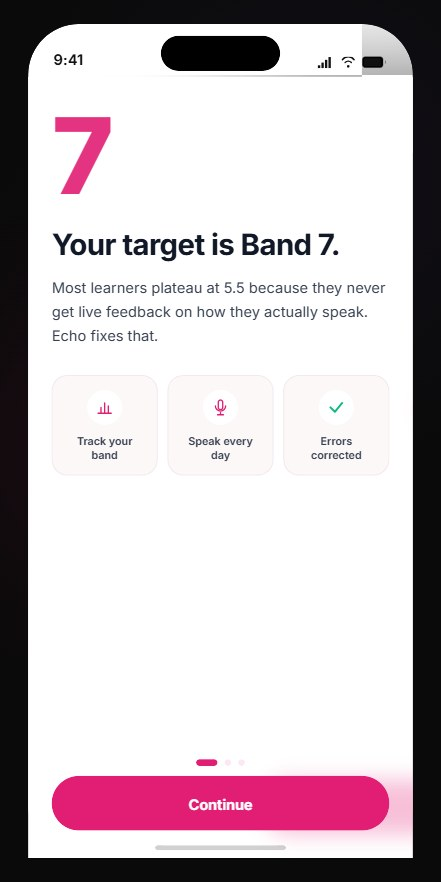
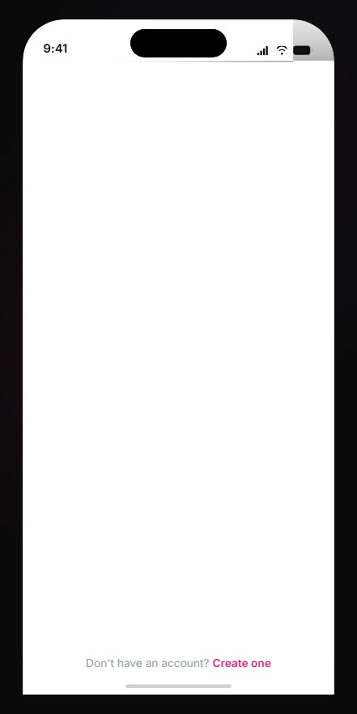
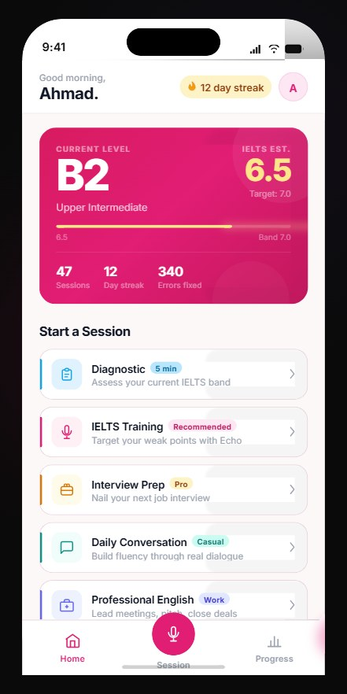
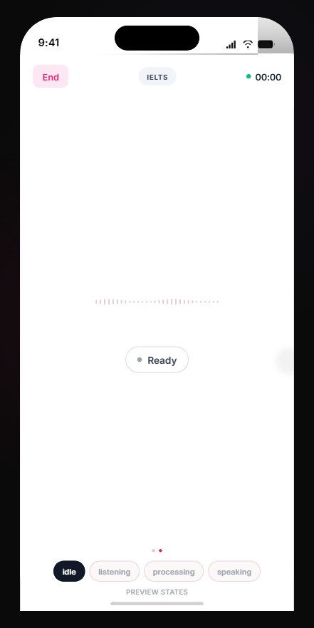
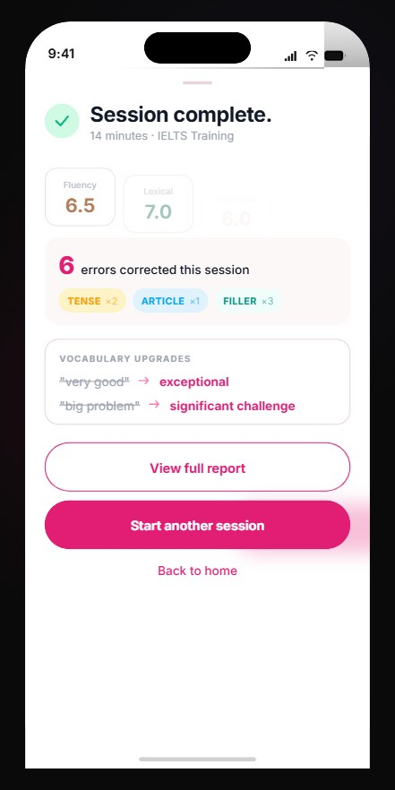
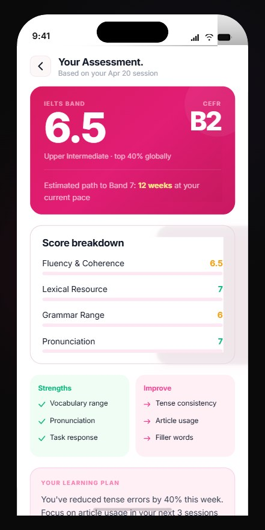
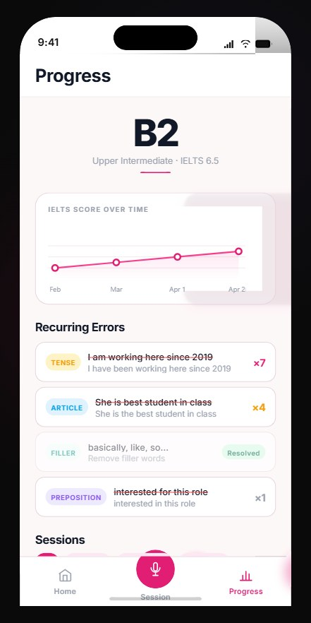

# Echo — AI English Coaching App

> Voice-first AI coach for IELTS Band 7+, interview prep, and professional English fluency.

Echo listens to you speak, catches grammar and vocabulary errors in real time, and gives you a personalised coaching session — all with under 750 ms end-to-end latency.

---

## Screenshots

<table>
  <tr>
    <td align="center"><b>Onboarding</b></td>
    <td align="center"><b>Sign In</b></td>
    <td align="center"><b>Home</b></td>
    <td align="center"><b>Live Session</b></td>
  </tr>
  <tr>
    <td></td>
    <td></td>
    <td></td>
    <td></td>
  </tr>
  <tr>
    <td align="center"><b>Session Complete</b></td>
    <td align="center"><b>Diagnostic Results</b></td>
    <td align="center"><b>Progress</b></td>
    <td align="center"><b>Error Detail</b></td>
  </tr>
  <tr>
    <td></td>
    <td></td>
    <td></td>
    <td></td>
  </tr>
</table>

---

## Tech Stack

| Layer | Technology |
|-------|-----------|
| Mobile | React Native + Expo SDK 54 |
| Routing | expo-router v6 |
| Backend | FastAPI (Python 3.11) + async WebSockets |
| Speech-to-text | Groq Whisper Large-v3 (~200 ms) |
| Language model | Groq Llama 3 8B / 70B (~200 ms first token) |
| Text-to-speech | Cartesia Sonic streaming / Edge TTS (dev) |
| Voice activity | Silero VAD via ONNX (on-device, 0 ms) |
| Database + Auth | Supabase (PostgreSQL + Row Level Security) |
| Session state | Upstash Redis |
| Hosting | Railway.app |

**End-to-end latency target: < 750 ms** (user finishes speaking → AI first word plays)

---

## Project Structure

```
echocoach/
├── backend/
│   ├── main.py                     # FastAPI app, CORS, router mounts
│   ├── routers/
│   │   ├── ws.py                   # WebSocket handler (core session loop)
│   │   ├── auth.py                 # /auth/register, /auth/login, /auth/profile
│   │   └── sessions.py             # /sessions REST endpoints + error tracking
│   ├── services/
│   │   ├── stt.py                  # Groq Whisper STT
│   │   ├── llm.py                  # LLM streaming (8B conversation, 70B diagnostic)
│   │   ├── tts.py                  # Cartesia / Edge TTS streaming
│   │   ├── correction.py           # Parallel grammar + vocab correction
│   │   └── redis_state.py          # Session state read/write
│   ├── prompts/
│   │   ├── diagnostic.py           # IELTS diagnostic prompt + JSON schema
│   │   ├── training.py             # Personalised coaching prompt builder
│   │   ├── correction.py           # Grammar/collocation correction prompt
│   │   └── interview.py            # Interview / STAR method prompt
│   ├── models/
│   │   ├── session.py              # SessionState Pydantic model
│   │   └── correction.py           # CorrectionCard Pydantic model
│   ├── db/
│   │   ├── schema.sql              # Full schema: users, sessions, errors + RLS
│   │   └── supabase.py             # Supabase client + token verification
│   ├── .env.example
│   └── requirements.txt
│
├── mobile/
│   ├── app/
│   │   ├── (auth)/
│   │   │   ├── login.tsx           # Sign in screen
│   │   │   ├── register.tsx        # Create account
│   │   │   └── post-reg.tsx        # Level + goal onboarding
│   │   └── (app)/
│   │       ├── index.tsx           # Home — mode selector + stats
│   │       ├── session.tsx         # Live voice session
│   │       ├── session-end.tsx     # Post-session summary
│   │       ├── diagnostic-results.tsx  # IELTS band result
│   │       ├── history.tsx         # Progress over time
│   │       ├── error-detail.tsx    # Grammar error deep-dive
│   │       └── profile.tsx         # User settings
│   ├── components/echo/
│   │   ├── shared.tsx              # BottomTabBar, EchoButton, CorrectionCard, Waveform
│   │   └── icons.tsx               # Icon components
│   ├── hooks/
│   │   ├── useVAD.ts               # Silero on-device VAD
│   │   ├── useWebSocket.ts         # WS connection + reconnect
│   │   └── useSession.ts           # Correction card queue
│   ├── services/
│   │   ├── supabase.ts             # Supabase client
│   │   └── api.ts                  # HTTP API wrapper (get/post/patch/delete)
│   ├── constants/tokens.ts         # Design tokens: colors, fonts, spacing
│   ├── assets/
│   │   ├── silero_vad.onnx         # VAD model (download separately, see Step 5)
│   │   └── screenshots/            # App UI screenshots
│   ├── .env.example
│   └── package.json
│
├── design-preview/                 # Static HTML design prototype
├── .env.example                    # Backend env template
└── README.md
```

---

## How a Session Works

```
User speaks  →  Silero VAD detects end-of-speech
             →  Audio chunks sent over WebSocket
             →  Groq Whisper transcribes (~200 ms)
             →  Groq Llama 3 8B streams reply (~200 ms first token)
             →  Cartesia / Edge TTS streams audio back (~300 ms first chunk)
             →  Correction service runs in parallel (doesn't block audio)
             →  CorrectionCard pushed to app while AI is still speaking
```

---

## Deployment (Production)

### Backend on Railway

```bash
npm install -g @railway/cli
railway login
cd backend
railway init
railway up
```

Set all env vars in Railway dashboard → **Variables**. Make sure to set `DEV_TTS=cartesia` and add your `CARTESIA_API_KEY`.

### Mobile build (EAS)

```bash
cd mobile
npm install -g eas-cli
eas login
eas build --platform android   # APK / AAB
eas build --platform ios       # requires Apple Developer account ($99/yr)
```

Update `EXPO_PUBLIC_BACKEND_HTTP_URL` and `EXPO_PUBLIC_BACKEND_WS_URL` to your Railway deployment URL before building.

---

## Session Modes

| Mode | Description |
|------|-------------|
| **Diagnostic** | 5-min assessment → CEFR band + IELTS estimate + learning plan |
| **IELTS Training** | Targeted practice on your weak areas |
| **Interview Prep** | STAR method coaching for job interviews |
| **Daily Conversation** | Casual fluency building |
| **Professional English** | Formal meetings and emails |
| **Accent Coaching** | British or American pronunciation focus |

---

## Testing Checklist

- [ ] `curl http://localhost:8000/health` returns `{"status":"ok"}`
- [ ] Register new user → JWT returned → stored in Supabase `users` table
- [ ] Start session → WS `session_ready` received in < 3 s
- [ ] Speak → transcription logged → AI responds → audio plays
- [ ] Interruption: speak over AI → AI stops immediately
- [ ] Correction card appears while AI audio is still playing
- [ ] Session end → scores written to `sessions` table
- [ ] Home screen shows correct streak + stats
